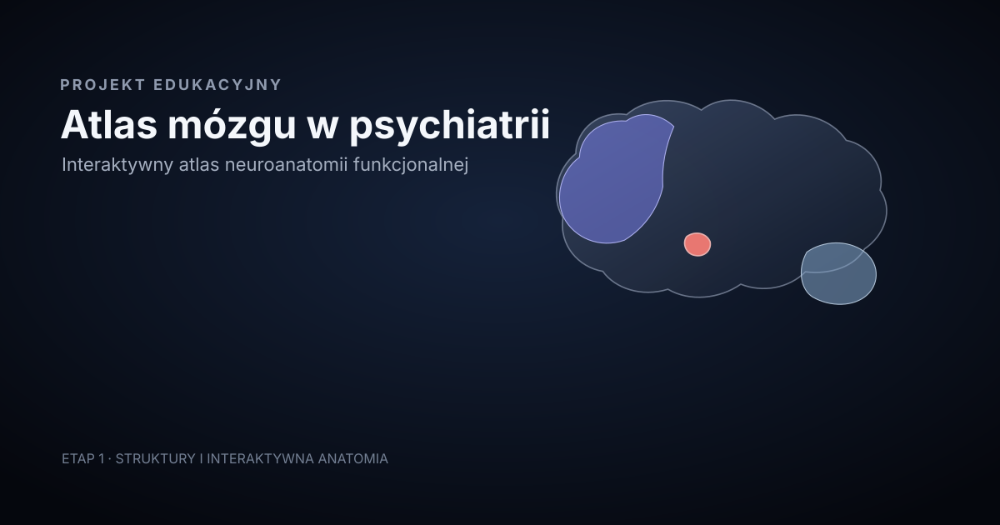

# Atlas mózgu w psychiatrii

**Interaktywny atlas neuroanatomii funkcjonalnej** — edukacyjna aplikacja, która łączy czytelną anatomię mózgu z funkcjonalnym językiem przydatnym w psychiatrii.



> Schemat edukacyjny. Lokalizacja struktur i granice obszarów mają charakter orientacyjny.

## Etap 1

Pierwszy etap udostępnia od razu właściwy atlas, bez strony marketingowej. Obejmuje:

- oryginalny, interaktywny boczny widok mózgu wykonany w SVG;
- 28 kluczowych struktur korowych, limbicznych, jąder podstawy, międzymózgowia, pnia mózgu i móżdżku;
- półprzezroczysty przekrój struktur głębokich, odróżniony od powierzchni kory;
- wybór struktur myszą, dotykiem i klawiaturą;
- stany zaznaczenia, struktur powiązanych i wygaszenia pozostałej anatomii;
- zoom, przesuwanie, gest pinch oraz podwójne dotknięcie wybranej struktury;
- hierarchię anatomiczną z zejściem do podstruktur PFC i prążkowia;
- panel `PODSTAWY | SZCZEGÓŁY` na desktopie i trzystanowy bottom sheet na telefonie;
- terminologię anatomiczną `PL | EN | LAT`, przy stale polskim interfejsie;
- wyszukiwanie po nazwach polskich (także bez znaków diakrytycznych), angielskich, łacińskich, skrótach i aliasach;
- bezpośrednie linki HashRouter, np. `/#/struktury/hipokamp`;
- onboarding zapamiętywany lokalnie oraz obsługę `prefers-reduced-motion`;
- przygotowane typy i warstwy stanu dla dalszych etapów.

Moduły **OBWODY** i **SIECI** są widoczne jako „W przygotowaniu”, ale nie udają nieistniejącej funkcjonalności.

## Technologia

- React 19 + TypeScript
- Vite
- React Router (`HashRouter`)
- natywne SVG i CSS
- Context + reducer
- Vitest + React Testing Library
- ESLint
- GitHub Actions + GitHub Pages

Aplikacja nie wymaga backendu, bazy danych ani zewnętrznego API.

## Uruchomienie lokalne

Wymagane są Node.js 24 i npm.

```bash
npm ci
npm run dev
```

Vite wyświetli lokalny adres, zwykle `http://localhost:5173`.

## Dostępne polecenia

```bash
npm run dev          # serwer deweloperski
npm run build        # kontrola TypeScript i build produkcyjny do dist/
npm run preview      # lokalny podgląd builda
npm run lint         # ESLint
npm test             # testy jednorazowe
npm run test:watch   # testy w trybie obserwacji
```

## Wdrożenie na GitHub Pages

Workflow [`.github/workflows/deploy.yml`](.github/workflows/deploy.yml) uruchamia się po pushu do `main` oraz ręcznie przez `workflow_dispatch`. Kolejno wykonuje:

1. `npm ci`;
2. `npm run lint`;
3. `npm test`;
4. `npm run build`;
5. publikację `dist/` oficjalnymi akcjami GitHub Pages.

Ścieżka bazowa Vite jest wyliczana w CI z nazwy repozytorium i przekazywana jako `VITE_BASE_PATH`. Nazwa repozytorium nie jest zaszyta w kodzie. `HashRouter` pozwala otwierać bezpośrednie adresy struktur bez serwerowych reguł 404.

W ustawieniach repozytorium GitHub należy wybrać **Settings → Pages → Source: GitHub Actions**. Następny push do `main` uruchomi publikację.

## Architektura

```text
src/
  app/                 provider, reducer, stan i routing
  components/
    brain/             interaktywny renderer i sterowanie
    layout/            shell desktop/mobile i nawigacja
    panels/            karta struktury i mobile bottom sheet
    search/            globalne wyszukiwanie
    onboarding/        pierwsze uruchomienie
  data/                treść anatomiczna i zarezerwowane moduły
  geometry/            wyłącznie geometria SVG i kotwice zoomu
  hooks/               stan, nawigacja, dialogi, reduced motion
  types/               model atlasu, anatomii i geometrii
  utils/               wyszukiwanie, terminologia, trasy, hierarchia
  styles/              tokeny, layout, SVG i animacje
  tests/               testy jednostkowe i integracyjne
```

Najważniejsza granica architektoniczna to rozdzielenie:

- **treści** — `src/data/structures.ts`;
- **geometrii** — `src/geometry/lateralGeometry.ts`;
- **stanu aplikacji** — `src/app/atlasState.ts` i `src/app/atlasReducer.ts`;
- **renderowania/interakcji** — `src/components/`.

Dzięki temu nowy opis, nowa ścieżka SVG albo kolejna nakładka nie wymagają przepisywania rdzenia.

## Model danych

`BrainStructure` zawiera stabilne `id` i `slug`, terminologię, aliasy, kategorię, relacje hierarchiczne, poziom głębokości, preferowane widoki, zwięzłą treść funkcjonalną, połączenia, neuroprzekaźnictwo, pola Brodmanna i referencje.

Stan atlasu rozdziela:

- **jeden główny wybór** (`primarySelection`);
- **wiele aktywnych warstw** (`activeLayerIds`).

To przygotowuje jednoczesne wyświetlanie struktury, obwodu, sieci i układu neuroprzekaźnikowego w kolejnych etapach. Puste, jawnie zarezerwowane zbiory znajdują się w plikach `circuits.ts`, `networks.ts`, `neurotransmitters.ts`, `symptoms.ts`, `disorders.ts` i `treatments.ts`.

## Jak dodać strukturę

1. Dodaj rekord `BrainStructure` do `src/data/structures.ts`.
2. Użyj stabilnego angielskiego `id` i polskiego slugu bez znaków diakrytycznych.
3. Uzupełnij nazwy `pl`, `en`, `la`, aliasy, kategorię i hierarchię.
4. Dodaj zwięzłą treść: rolę, 3–5 funkcji, lokalizację, wejścia, wyjścia i powiązania.
5. Jeśli struktura ma być widoczna w bocznym widoku, dodaj geometrię o tym samym `structureId`.
6. Dodaj lub rozszerz test wyszukiwania i interakcji.

Nie należy wpisywać opisów anatomicznych do komponentów SVG.

## Jak dodać geometrię SVG

Dodaj obiekt `BrainRegionGeometry` do `src/geometry/lateralGeometry.ts`:

- `structureId` łączy ścieżkę z rekordem treści;
- `path` zawiera wyłącznie dane ścieżki SVG;
- `layer` określa powierzchnię kory, anatomię głęboką albo strukturę zewnętrzną;
- `labelAnchor` ustala położenie etykiety;
- `zoomAnchor` ustala środek i preferowany poziom powiększenia.

Interaktywność, etykiety ARIA, kolory kategorii i stany wyboru zostaną dodane przez wspólny `StructureOverlay`.

## Terminologia PL / EN / LAT

Przełącznik zmienia podstawową nazwę anatomiczną w eksploratorze, etykietach SVG, panelu i wynikach wyszukiwania. Elementy interfejsu pozostają po polsku. Wyszukiwarka indeksuje jednocześnie wszystkie warianty, skrót i aliasy, a przed porównaniem normalizuje wielkość liter, odstępy, interpunkcję i polskie znaki.

## Testy

Zestaw obejmuje:

- normalizację wyszukiwania czterech wariantów nazwy ciała migdałowatego;
- przełączanie PL/EN/LAT;
- wybór, odznaczenie, terminologię, zoom i poziom anatomii w reducerze;
- bezpośrednią trasę struktury i polski stan błędu;
- wybór regionu SVG myszą i klawiaturą;
- odczyt systemowej preferencji ograniczenia animacji.

## Roadmapa

- **Etap 1** — struktury i interaktywna anatomia
- **Etap 2** — obwody neuronalne
- **Etap 3** — sieci funkcjonalne
- **Etap 4** — neurochemia
- **Etap 5** — funkcje i objawy
- **Etap 6** — zaburzenia psychiczne
- **Etap 7** — leczenie i mechanizmy działania
- **Etap 8** — bibliografia i poziomy dowodów

## Autorstwo i licencje

**Atlas mózgu w psychiatrii**  
Projekt edukacyjny  
lek. Aleksy Kasperowicz, specjalista psychiatra

Kod: [MIT](LICENSE). Oryginalne treści edukacyjne i ilustracje SVG: [CC BY 4.0](CONTENT-LICENSE.md).
